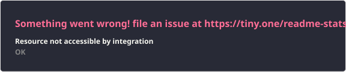

<h2 data-importer="text" align="left">Hi 👋! Welcome to My GitHub!</h2>

###

<div data-importer="stats" align="center">
  
  
</div>

###

<p data-importer="text" align="left">```php<br><?php<br><br>//Hello World<br><br>$loghan = [<br>    'nome'        => 'Loghan Lima Tavares',<br>    'local'       => 'Juazeiro do Norte, CE',<br>    'formacao'    => 'Análise e Desenvolvimento de Sistemas @ UNIFAP',<br>    'experiencia' => [<br>        'Estagiário de Desenvolvimento Mobile @ Brisanet (Flutter/Dart)',<br>        'Desenvolvedor Backend voluntário @ NexTi (PHP)',<br>    ],<br>    'stack' => [<br>        'mobile'      => ['Flutter', 'Dart'],<br>        'backend'     => ['PHP'],<br>        'games'       => ['Godot'],<br>        'ferramentas' => ['Git', 'GitHub', 'Linux'],<br>    ],<br>    'buscando'    => 'Estágio em desenvolvimento mobile ou backend',<br>];<br>```</p>

###

<div data-importer="techs" align="left">
  
  
  
  
  
  
  
  
  
  
  
  
  
  
  
  
  
  
  
  
  
  
  
  
  
  
  
  
  
  
  
</div>

###


###

<div data-importer="socials" align="left">
  
  
  
  
</div>

###

<picture data-importer="pacman">
  <source media="(prefers-color-scheme: dark)" srcset="https://raw.githubusercontent.com/Loghan454/Loghan454/pacman-output/bomberman-contribution-graph-dark.svg?game=bomberman">
  <source media="(prefers-color-scheme: light)" srcset="https://raw.githubusercontent.com/Loghan454/Loghan454/pacman-output/bomberman-contribution-graph.svg?game=bomberman">
  
</picture>

###
