Olá 👋! Bem-vindo ao meu GitHub!

php
<?php

declare(strict_types=1);

final class Desenvolvedor
{
    public function __construct(
        public readonly string $nome,
        public readonly string $local,
        public readonly string $formacao,
        public readonly array $experiencia,
        public readonly array $stack,
        public readonly string $objetivo,
    ) {}
}

$loghan = new Desenvolvedor(
    nome: 'Loghan Lima Tavares',
    local: 'Juazeiro do Norte, CE',
    formacao: 'Análise e Desenvolvimento de Sistemas @ UNIFAP',
    experiencia: [
        'Estagiário de Desenvolvimento Mobile @ Brisanet (Flutter/Dart)',
        'Desenvolvedor Backend voluntário @ NexTi (PHP)',
    ],
    stack: [
        'mobile'      => ['Flutter', 'Dart'],
        'backend'     => ['PHP'],
        'games'       => ['Godot'],
        'ferramentas' => ['Git', 'GitHub', 'Linux'],
    ],
    objetivo: 'Estágio em desenvolvimento mobile ou backend',
);

              
   
     
   <picture> <source media="(prefers-color-scheme: dark)" srcset="https://raw.githubusercontent.com/Loghan454/Loghan454/pacman-output/bomberman-contribution-graph-dark.svg?game=bomberman"> <source media="(prefers-color-scheme: light)" srcset="https://raw.githubusercontent.com/Loghan454/Loghan454/pacman-output/bomberman-contribution-graph.svg?game=bomberman">  </picture>
